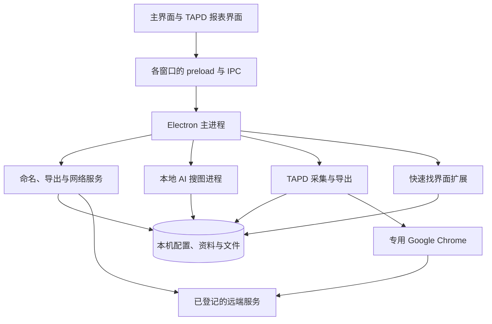

# NGR AssetPilot v3.0.24 系统架构

<!-- markdownlint-disable MD013 -->

> **版本范围（2026-11-06）**：本文以正式发布标签 [v3.0.24](https://github.com/907609732/NGR-AssetPilot-App/tree/v3.0.24) 的源码为依据，对应提交 `0478591260a18cf225eb6b59b08744e98a76d36f`。本次只同步 `main` 的 Markdown 文档；`main` 的程序版本仍为 `3.0.11`，没有合并新版程序。文中所有代码路径、模块与运行行为均应在 **v3.0.24 标签**中查看，不能据此认为默认分支已包含新版功能。

本文记录桌面产品的模块、数据流、存储与网络边界。普通用户的安装和操作步骤见[使用教程](NGRAI辅助UI切图命名工具-使用教程脚本与图文教程.md)；开发者应先取得对应版本源码，再参照[桌面开发说明](../README-DESKTOP.md)。

## 产品定位与架构原则

NGR AssetPilot 是面向游戏 UI 美术、技术美术和资源管理人员的 Windows 本地资源工作台，主要解决批量命名、命名规范管理、切图检测、进度保存、资源导出、本地相似图检索，以及 TAPD 周报、月报和 Bug 媒体整理问题。快速找界面由独立扩展提供。

当前架构遵循以下原则：

- **本地单机优先**：核心工作流、项目配置、图片和本地 AI 索引均保存在用户电脑上。
- **桌面端为正式产品**：Electron 桌面应用是主要运行形态；浏览器直开仅作为历史兼容或开发辅助，不要求与桌面端保持完整功能对等。
- **源资源只读**：图库分析和相似图搜索不修改源图片；删除图库只删除应用数据目录中的索引和缩略图。
- **最小桌面权限**：Renderer 不直接获得 Node.js、任意系统路径或通用 Electron 能力，敏感操作必须经过 preload 和主进程校验。
- **离线能力优先**：模型就绪后，本地图库分析和搜索不依赖网络；模型支持离线包导入。图像单塔模型只支持以图搜图，文字搜索需要图文模型。AI 视觉命名、在线翻译和 TAPD 仍需对应网络服务。
- **可信网络目标**：外部 AI 服务通过主进程代理访问；除内置 Provider 外，用户可显式登记精确的可信 HTTPS 服务，或登记精确 host、端口和 basePath 的本地 loopback 服务，Renderer 不能提交任意网络地址。
- **单机业务边界**：没有用于项目账号、RBAC、多人协作或云同步的中心业务服务器。百度 CFC 翻译中转、所选 AI 服务和 TAPD 是各自独立的远端服务，不能将整个软件描述为完全离线。

## 系统关系

主界面以 HTML、CSS 和分模块 JavaScript 实现；TAPD 报表使用单独的 React 界面及 preload。两者通过各自受控接口请求主进程，不能直接调用任意 Node.js 或 Electron API。本地 AI 的索引、查询和状态计算运行在分开的 utility process 中；扩展校验与解压运行在 Node Worker 中，扩展工作台模块由宿主主进程加载。

| 边界 | v3.0.24 的实现 |
| --- | --- |
| 本机业务服务 | Electron 主进程编排凭据、目录授权、导出、更新、诊断、TAPD、搜图和扩展 |
| 本机任务 | Worker、utility process 和隔离探测子进程；没有 Redis 或云端队列 |
| 账号与授权 | 没有 NGR 云账号和团队 RBAC；API 凭据依赖 Windows 用户边界，TAPD 登录保存在其专用 Chrome 资料中 |
| 外部服务 | AI / 翻译、模型下载、TAPD、更新及用户选择的诊断目标，按各自功能发起请求 |
| 官网 | 独立的 Vinext / React 与 Cloudflare Worker 工程，提供介绍和下载入口；不承载桌面工作区 |
| 日志与监控 | 本地轮转日志、诊断历史和任务状态；没有自动上传本地图片或工作区的集中监控 |

官网仍保留 D1、Auth 和示例脚手架，不能据此认为桌面端已有在线账号、云数据库或云同步。

## 核心模块与职责

| 模块 | 主要位置 | 职责 |
| --- | --- | --- |
| Renderer 应用 | `app/index.html`、`app/js/`、`app/styles.css` | 界面、命名工作流、检测规则、项目/方案、编辑、搜索 UI 和本地状态编排 |
| Electron 启动层 | `desktop/main/bootstrap.mjs` | 版本身份、数据目录、单实例、窗口、协议、服务实例和退出流程 |
| 安全与 IPC | `desktop/main/security.mjs`、`protocol.mjs`、`ipc.mjs`、`desktop/preload/` | 沙箱、CSP、导航限制、可信 IPC 和最小能力桥 |
| 通用桌面服务 | `desktop/services/` | Provider 注册、DPAPI 凭据、受限网络、目录 token、流式迁移备份、本地日志和应用更新 |
| 网络与 API 诊断 | `desktop/services/network-diagnostics-service.mjs`、`app/js/network-diagnostics.js` | 无凭据服务目录、系统代理/直连探测、自定义目标安全校验、脱敏历史与导出 |
| 本地搜图控制层 | `desktop/services/local-image-search/controller.mjs` | 对外接口、请求校验、图库/模型/任务状态、缩略图和打开定位 |
| 本地搜图存储层 | `desktop/services/local-image-search/storage.mjs` | SQLite schema、图库、图片元数据、模型注册和向量状态 |
| 模型管理 | `desktop/services/local-image-search/model-manager.mjs` | 内置模型下载、哈希校验、离线包和自定义模型生命周期 |
| 推理与检索 | `engine.mjs`、`engine-worker.mjs` | 索引/查询/状态隔离进程、DirectML/CPU 调度、图像预处理、批量推理、素材分页、向量缓存和精确 Top-K |
| 基地提单表 | `app/js/daily-report.js`、`daily-report-core.js`、`desktop/services/daily-report-export.mjs` | 本机解析粘贴的日报、核对日期和人天、编辑任务行及导出 Excel；不依赖 TAPD 采集或在线 AI |
| TAPD 报表 | `integrations/tapd-report/src/`、`desktop/services/tapd-report-window.mjs`、`desktop/preload/tapd-report.cjs` | 专用 Chrome 采集、周/月报汇总、等级与分类调整、Excel 导出；构建结果写入 `app/tapd-report/` 和 `tapd-report-runtime.mjs` |
| Bug 媒体 | `integrations/tapd-report/src/main/bug-images.ts`、`bug-media.ts`、`integrations/tapd-report/src/renderer/BugMediaBrowser.tsx`、`desktop/services/tapd-media-response.mjs` | 描述/评论/附件媒体提取、按单号索引、原图复制与视频按需播放 |
| 扩展工作台 | `desktop/services/interface-finder-extension.mjs`、`finder-extension-files.mjs`、`finder-extension-worker.mjs`、`build/extensions.json` | ZIP 导入、清单与哈希校验、持久校验记录、工作台生命周期；安装目录共享，业务资料按宿主身份存储 |
| ArtHub 与系统工具 | `desktop/services/arthub-folders.mjs`、`keep-awake.mjs`、`auto-start.mjs`、`desktop/main/tray-controller.mjs` | ArtHub 只读目录查询、保活模式、当前用户启动项和系统托盘 |
| 官网 | `website/` | 产品介绍、经过校验的安装包下载入口；不承载桌面端业务数据 |
| 构建与发布 | `build/`、`scripts/`、`.github/workflows/` | 三版本打包、依赖检查、测试、凭据扫描、SBOM、哈希和 GitHub Release |

## 依赖与复用边界

本地素材库继续复用已有的 `node:sqlite` 图片元数据、模型向量索引和受限 IPC，没有嵌入另一套完整素材管理器。现有交互包括多图库、增量扫描、文件夹浏览、固定 100 张分页、缩略图懒加载、旧响应失效，以及以 `libraryId + imageId` 绑定操作身份。

TAPD 使用 `sql.js` 保存报表，使用 `exceljs` 导出 Excel，使用 `playwright-core` 驱动已安装的 Google Chrome。它与本地搜图的 `node:sqlite` 数据库是两个独立模块。TAPD 的 TypeScript / React 由 esbuild 编译；日常源码启动会先准备这些产物，不需要生成安装包。

此前文档列出的其他素材管理器和界面组件属于设计参考或候选方案，不代表当前安装包已包含其代码。实际分发依赖以 [v3.0.24 package.json](https://github.com/907609732/NGR-AssetPilot-App/blob/v3.0.24/package.json)、锁文件、[第三方声明](https://github.com/907609732/NGR-AssetPilot-App/blob/v3.0.24/THIRD-PARTY-NOTICES.md)及该 Release 的 SBOM 为准；后续实际引入组件时再核对相应版本及文件许可证。

## 关键业务数据流

### 1. 图片命名

| 阶段 | 执行位置与数据流 |
| --- | --- |
| 导入与规则 | Renderer 接收用户选择的图片和参考图，读取项目方案、词库及本地历史知识 |
| 本地命名 | 本地知识库在页面侧生成推荐词；内置离线翻译通过桌面翻译服务执行，不需要发送图片 |
| AI / 在线翻译 | Renderer 提交 `providerId + requestId + operation + body`；主进程解析已登记服务与 DPAPI 凭据，检查 URL、方法、大小、重定向和超时后请求服务 |
| 人工确认 | 推荐结果回到 Renderer，用户编辑最终名称、批量前缀和后缀，并处理重名冲突 |
| 持久化 | 项目设置写入 localStorage，工作记录、图片 File 与参考图增量写入 IndexedDB |

AI 视觉命名会发送用户选用的图片、参考图和命名上下文；百度文本翻译发送待译文本。已保存的 Provider 密钥由主进程使用，常规 Renderer 查询只返回元数据和 `hasSecret`。

### 2. 文件导出

Renderer 只生成相对目录和最终文件名。用户在主进程目录选择器中选择目标目录后，主进程签发与当前窗口绑定的目录 token；后续图片按块写入，并在每次操作时重新校验安全相对路径。导出过程只改目标文件名，不重新编码图片内容。

### 3. 本地 AI 搜图

| 阶段 | 执行路径与边界 |
| --- | --- |
| 创建图库 | 用户通过系统目录选择器授权源目录；Renderer 保存 `libraryId`，不向检索接口提交任意系统路径 |
| 准备模型 | ModelManager 下载并校验模型，或导入离线包；自定义 ONNX 先经过隔离子进程验证 |
| 建立索引 | Controller 校验图库和模型，Engine 调度索引 utility process；扫描、哈希与 Sharp 预处理后用 ONNX Runtime 批量推理，以短事务写入 SQLite |
| 素材浏览 | 查询进程串行读取文件夹、筛选和排序结果；按 100 张分页返回不含绝对路径的元数据，Renderer 按需加载缩略图 |
| 图片 / 文字查询 | 查询进程生成单条查询向量，并进行精确 Top-K；是否支持文字取决于模型能力 |
| 定位源文件 | Renderer 提交 `libraryId + imageId`；主进程重新核对真实路径后打开或定位原文件 |

索引、查询和状态进程分别管理生命周期，避免长时间建库直接阻塞界面或所有查询。DirectML 可用于支持的索引任务；设备或模型不适用时使用 CPU 路径。GPU、驱动与模型需要通过相应探测，不能把 DirectML 描述为所有电脑均可用。

模型与索引关系为：

- `libraries` 保存图库定义。
- `images` 保存与模型无关的图片路径、mtime、大小、SHA-256 和尺寸。
- `models` 保存模型注册信息和指纹。
- `library_models` 保存每个图库在某个模型下的索引状态与执行配置。
- `image_embeddings` 按 `libraryId + imageId + modelId + fingerprint` 隔离向量。
- 新安装默认视觉塔是固定 revision 和 SHA-256 的 q4f16 模型；旧动态量化视觉塔以独立兼容模型保留，只允许 CPU batch 1 重建，避免继续产生不稳定的批量向量。
- 执行 profile 是覆盖模型、预处理、ONNX Runtime、provider、batch、设备、驱动与架构的 SHA-256；profile 变化会要求完整重建，禁止混合写入。
- 查询进程只保留当前活动图库、当前模型的连续向量和 imageId；超过 300 MiB 时改用 SQLite 分块精确 Top-K。

### 4. 网络与 API 连通性诊断

诊断服务与读取业务凭据的 `NetworkClient` 分开实现。Renderer 先保存或选择目标，然后提交 `targetId` 列表与路线模式；主进程校验后使用系统代理路线、独立内存 Session 的直连路线，或两者对比，收集 DNS、代理类型、TLS、HTTP 状态与耗时。

| 约束 | 实际行为 |
| --- | --- |
| 网络目标 | 远端使用 HTTPS；localhost HTTP 必须带端口；内网目标需显式确认；对云元数据、链路本地、保留地址和解析后的未授权地址执行检查 |
| 凭据 | 不读取 Provider 密钥，请求使用 `credentials: omit`；不继承业务 API 的鉴权 |
| 请求方法 | 内置目标主要使用 HEAD / GET；自定义非安全方法需要逐次确认，不能将其误解为所有诊断请求都只读 |
| 内容 | 不保存响应正文；自定义目标可保存受限请求体，不能把密钥放入诊断 URL、名称或请求体 |
| 容量 | 最多 100 个自定义目标、每次 50 个目标、保留最近 30 次脱敏运行 |
| 解释 | 收到 401、403、405、429 或 5xx 说明已有 HTTP 响应，应区分需鉴权、限流、服务错误与 DNS / TLS 失败 |

连通性诊断成功不等于业务调用成功；翻译能否正常返回仍应使用对应翻译测试。历史记录和 JSON / Markdown 导出用于查看网络状态，不会自动上传本地图片或诊断历史。

### 5. 应用更新

正式安装版通过 `electron-updater` 读取 GitHub Release 的 `latest.yml`。软件启动后延迟检查，并每 6 小时检查一次；用户也可在“设置 → 数据与关于”手动检查。

发现新版本后，用户点击“下载更新”才开始下载。**下载完成后软件自动保存工作区、关闭、静默安装并重新打开，不再要求点击第二次“确认安装”。** `UpdaterController` 关闭自动下载和退出时自动安装，在下载完成事件后显式调用 `quitAndInstall(true, true)`。

v3.0.24 正式发布仅提供 Windows x64 Setup；portable 是内部构建选项，界面引导手动下载。源码开发版和测试版不走正式应用内更新。此版本沿用未签名构建策略，不能把文件哈希校验等同于 Authenticode 发布者身份验证。

### 6. TAPD 报表与 Bug 媒体

`integrations/tapd-report` 将页面采集、报表计算、导出和 React 界面分开。`tapd-report-window.mjs` 创建专用窗口和受控 IPC，懒加载编译后的 `tapd-report-runtime.mjs`。采集器通过 `playwright-core` 的 `channel: "chrome"` 启动持久化浏览器上下文，因此电脑需安装 **Google Chrome**；用户在专用 Chrome 中登录 TAPD，采集复用该登录状态。

| 阶段 | 实现与用户可见结果 |
| --- | --- |
| 采集 | 读取 TAPD“我的工作”中的已办记录，按所选日期抓取；周报提供本周、上周、今天等快捷日期；旧快照不会自动重新访问 TAPD |
| 分类与等级 | 共享报表层应用分类规则、人工调整和人天配置。等级优先级为人工选择、标题、修复分支；标题缺等级时读取详情异步加载的“修复分支”，如 `Trunk_S2` |
| 报表 | 周报正文显示 S 等级，并可选日期、人天；月报使用 `exceljs` 和内置模板生成 Excel，未确认事项可先导出草稿 |
| 媒体提取 | 从 Bug 描述、评论和附件识别可下载图片与视频；最多同时读 2 个详情页、下载 4 项，按单号保存并记录失败项 |
| 浏览 | Bug 媒体页按单号或标题查询；缩略图只用于预览，查看原图和复制使用保存的完整图片，视频经受限响应流按需播放 |
| 月报附图 | 导出时读取当前报告范围内已提取的图片，放入 `Bug图片附件` 工作表；不嵌入视频，不会在导出按钮点击后自动补抓全部图片 |

单图片限 50 MB，单视频限 250 MB；支持可下载的 MP4、WebM、MOV/M4V，不能直接下载的 blob、HLS / DASH 播放列表会记录失败。媒体目录被移动或删除时需要重新提取。过滤 TAPD 全局 AI 助手宣传图的修复不会自动清理既有导出目录。

**资料隔离例外**：正常运行时，TAPD 使用 `%APPDATA%\TAPD月报工具`，其中 `reports.sqlite` 是报表数据库，`tapd-browser/` 是专用 Chrome 资料。正式、开发、测试身份可能共用这份资料，不能笼统称为三版完全隔离。只有设置 `NGR_E2E_USER_DATA` 的验收环境改为当前 `userData/tapd-report/`。图片和视频保存在用户选择的导出目录，不属于主命名工作区的 `.ngrap` 备份。

### 7. 快速找界面扩展与其他服务

快速找界面通过单独交付的扩展 ZIP 接入，扩展与模型不随宿主安装器附带。[扩展登记文件](https://github.com/907609732/NGR-AssetPilot-App/blob/v3.0.24/build/extensions.json)记录已验证扩展 `0.7.0`、最低宿主 `3.0.18`，并明确扩展包尚未公开下载。项目公开的旧独立版不能作为该扩展导入；登记的生产包验收范围也不等于已经完成真实双机 NAS 验收。

导入流程在 Node Worker 中读取 ZIP，检查唯一版本目录、`extension.json` 身份与宿主接口、载荷白名单、文件大小、数量和 SHA-256，再写入临时目录。校验成功后才切换 `current.json` 指向的版本。升级前应关闭扩展工作台；模型和项目资料与安装载荷分开保存。

| 情况 | v3.0.24 校验行为 |
| --- | --- |
| 首次导入 / 点击“重新检查” | 完整读取并校验文件内容 |
| 日常打开 | 检查清单、文件集合和文件元信息；与持久记录一致时复用已验证结果 |
| 文件变化、记录缺失或损坏 | 回退到完整校验；缺失、额外文件及目录联接仍会被检查 |
| 旧安装首次打开 | 建立一次完整校验记录，后续跨软件重启复用 |

安装位置为共享的 `%APPDATA%\NGR\extensions\quick-interface-finder/`，`current.json` 和 `verification.json` 也在其中；不同宿主身份使用各自的 `userData/extensions-data/quick-interface-finder/` 与 `extensions-cache/quick-interface-finder/`。扩展模块由宿主主进程加载，复用 Electron 环境；这些清单与哈希检查不是通用的不可信插件沙箱，应使用受信任的正式扩展包。

ArtHub 服务只查询文件夹；客户端精确定位协议尚未完成真实验证。百度 CFC 翻译密钥保存在服务端环境变量，宿主托管配置只保存公开 Endpoint；用户自行配置的其他 Provider 凭据则由本机 CredentialStore 管理。

## 本地数据与存储边界

宿主主工作区的 `userData` 按身份区分：正式版通常为 `%APPDATA%\NGR AssetPilot`，开发版为 `%APPDATA%\NGR AssetPilot Dev`，测试版为 `%APPDATA%\NGR AssetPilot Test`。**TAPD 资料根与快速找界面安装目录是共享例外**，见下表；不要据此推导所有模块都完全隔离。

| 数据 | 存储位置 | 迁移与备份边界 |
| --- | --- | --- |
| 项目、方案、规则、显示设置 | 当前宿主 origin 的 localStorage | 主工作区 `.ngrap` 导出范围 |
| 命名记录、导入图片副本、参考图 | 当前宿主的 IndexedDB | 主工作区 `.ngrap` 导出范围 |
| API 凭据 | 当前宿主 `userData` 内的 DPAPI 加密文件 | 新桌面工作区备份不导出凭据；仍兼容旧加密凭据块导入，换电脑后按需重新配置 |
| 图库、图片元数据和向量 | `userData/local-image-search/index.sqlite3` | 独立管理，SQLite WAL；不属于命名工作区备份 |
| ONNX 模型 | `userData/local-image-search/models/` | 内置模型可导出 / 导入 `.ngrmodel` 离线包；自定义 ONNX、外部权重、tokenizer 经向导管理 |
| 搜索缩略图 | `userData/local-image-search/thumbnails/` | 可重建缓存，不进入命名工作区备份 |
| 搜图库原文件 | 用户选择的原目录 | 索引和搜索只读；删除图库不删除这些源文件 |
| 运行日志 | 当前宿主 `userData` | 脱敏、轮转记录版本、阶段、操作 ID、错误码与进程退出信息 |
| 诊断目标与历史 | `userData/network-diagnostics/` | 原子 JSON；自定义目标及最近 30 次运行独立管理，不保存响应正文 |
| TAPD 报表与设置 | `%APPDATA%\TAPD月报工具/reports.sqlite` | 正常运行可能被三种宿主身份共用；由 TAPD 模块管理 |
| TAPD 登录状态 | `%APPDATA%\TAPD月报工具/tapd-browser/` | 专用 Chrome 资料；不进入命名工作区备份 |
| TAPD 图片和视频 | 用户选择的媒体导出目录 | 保持目录可用；月报只嵌入当前范围的已提取图片 |
| 快速找界面安装载荷 | `%APPDATA%\NGR\extensions\quick-interface-finder/` | 宿主身份间共享；安装版本指针和校验记录独立于业务资料 |
| 快速找界面资料与缓存 | 各宿主 `userData/extensions-data/`、`extensions-cache/` | 独立管理，不包含在命名工作区 `.ngrap` 中 |

工作区迁移是命名工作区的数据迁移，不是整台电脑或全部模块的镜像。浏览器兼容模式使用其当前 origin 的 localStorage / IndexedDB，与 Electron 桌面数据不自动互通。更换电脑或清理数据前，应分别处理命名工作区、搜图源库与模型、TAPD 资料及扩展项目。

## 网络与隐私边界

| 功能 | 可能发送到网络的数据 |
| --- | --- |
| 本地知识库、切图检测、离线翻译 | 这些处理在本机完成，不需要上传图片 |
| 本地 AI 搜图 | 模型准备可能下载文件；模型就绪后的图库分析和查询在本机完成 |
| AI 视觉命名 | 选用的切图、参考图和相关命名上下文发送给所选 Provider |
| 在线文本翻译 | 待译文本发送至所选翻译服务；托管方式经过相应 CFC Endpoint |
| TAPD | 使用用户在专用 Chrome 建立的登录会话读取 TAPD 页面及相关媒体 |
| 网络诊断 | 向选定目标发起探测；不读取业务 Provider 密钥，不保存响应正文 |
| 更新与模型分发 | 请求 GitHub Release 元数据、安装包或相应模型文件 |

因此，“本地优先”描述核心数据和计算位置，不代表所有功能离线，也不代表第三方服务没有各自的数据处理规则。

## 安全边界

1. Renderer 视为低权限 UI，不直接拥有 Node.js 和文件系统能力。
2. preload 只暴露固定、递归冻结的接口，不暴露原始 `ipcRenderer`。
3. 主界面 IPC 验证当前主窗口、主 Frame 和受信任的 `ngr-assetpilot://app` 来源；TAPD IPC 另外绑定其报表窗口及主 Frame，不接受任意同源窗口代发请求。
4. 文件、图库和模型路径优先由主进程系统对话框产生，Renderer 使用 ID 或 capability token。
5. 已保存密钥只在主进程 ProviderRegistry 与 CredentialStore 中解密；网络请求以 `providerId + operation + body` 提交，并限制协议、精确 origin/basePath、方法、大小、同源重定向、超时和取消。
6. 连通性诊断使用独立服务；Renderer 只能运行已登记 targetId。非安全 HTTP 方法逐次确认，对远程明文、元数据地址、未确认内网和 DNS 解析后的禁止地址执行拒绝检查。
7. 自定义模型先在隔离子进程验证；运行阶段关闭远程模型访问，禁止脚本、自定义算子 DLL 和越界外部数据。导入成功表示通过当前验证流程，不保证支持任意模型架构或任意硬件。
8. 索引、查询和状态进程彼此隔离；异常退出、无响应和超时会拒绝 pending 请求并按需重建。
9. 打包流程排除本地 API 配置和测试密钥，并生成 SBOM、哈希与构建清单；GitHub Actions 第三方步骤固定到完整 commit SHA。
10. NGR 云翻译安装包只保存公开的百度 CFC HTTPS Endpoint；百度 APPID/密钥存在于 CFC 环境变量。旧 v1 托管配置可读取 Endpoint，但共享 Bearer Token 被丢弃且不再发送。服务端部署仍需自行管理配额和限流。
11. TAPD 媒体播放使用已登记本地文件和受限响应流；打开原始单据链接需符合允许的 TAPD 主机及路径。
12. 扩展完整性校验、运行时进程隔离和发布者数字签名是不同边界。当前扩展在宿主内执行，当前正式安装包未签名，不能互相替代。

## 当前架构优势

- Electron 主进程、preload、Renderer 的安全职责划分清楚。
- 本地 AI 已拆分 Controller、Storage、ModelManager、Engine 和 Worker，不是直接堆在 UI 中。
- 图片元数据与模型向量分离，可以支持多个模型和不同向量维度。
- 正式版、开发版、测试版的主工作区、应用身份和构建产物分开；TAPD 资料与扩展安装共享的例外需要在开发和迁移时单独处理。
- 本地优先设计与产品用户处理未公开美术资源的隐私需求匹配。
- 源图库只读、搜索查询不保存，降低了误删与隐私风险。
- 精确依赖、自动化测试、安装包验证和 Release 元数据已经形成稳定发布主干。

## 已知约束与演进重点

以下内容是后续改进方向，不代表需要重写整个项目：

1. **Renderer 模块化**：当前仍依赖多个按顺序加载的全局脚本和共享可变状态。新增功能会同时触及 HTML、CSS、状态、事件、持久化和测试，应逐步迁移到明确的 ES Module 和功能边界。
2. **版本化数据迁移**：localStorage、IndexedDB、DPAPI、SQLite、模型文件和缩略图均有独立生命周期，需要统一的数据版本、迁移、容量和崩溃恢复策略。
3. **迁移包兼容与容量**：桌面导出使用 fflate 分块流式 ZIP；导入必须持续保留路径、条目、哈希、总大小和事务回滚门禁，并对旧 v1/加密包做回归测试。
4. **发布信任（证书待配置）**：v3.0.24 使用未签名策略，`verifyUpdateCodeSignature` 未启用。HTTPS 下载、安装包哈希、凭据扫描和构建清单不能替代发布者签名；本地构建成功也不等于安装或公开发布验收完成。
5. **诊断导出与崩溃恢复**：已有本地脱敏轮转日志和进程恢复，后续可增加由用户主动确认的诊断包；不得默认上传本地图片、查询或提示词。
6. **版本与文档同步**：本次文档对齐 v3.0.24，但默认分支程序仍为 v3.0.11。以后应在发布流程中同时核对默认分支介绍、安装入口、版本说明和对应源码，避免读者将文档同步误认为程序同步。
7. **资料隔离**：TAPD 的共享资料根、扩展共享安装与分版业务资料有不同生命周期；后续应明确迁移与并行运行策略。
8. **官网边界清理**：官网应同步正式 Release 信息，并移除或隔离未使用的 D1、Auth 和示例脚手架，减少版本和依赖漂移。

## 长期演进判断

在“本地单机优先、桌面端为主”的产品方向下，当前分层与产品目标基本匹配，不需要立即引入微服务或进行大规模重写。能否长期保持低维护成本，取决于上述模块化、迁移、任务调度、资源上限、签名和诊断问题是否持续得到治理。

建议保持 Electron 服务层和本地 AI 分层，通过小步演进解决 Renderer 模块边界、数据迁移、任务调度、资源上限、更新签名和诊断能力。只有在产品明确进入在线账号、多人协作或云同步阶段时，才需要新增独立远程 Backend、Authentication、RBAC、同步协议和服务端数据模型。

## 核对本架构的源码入口

以下链接固定到本文所述版本，适合在 `main` 只更新文档时核查：

- [版本与依赖](https://github.com/907609732/NGR-AssetPilot-App/blob/v3.0.24/package.json)、[启动与服务组装](https://github.com/907609732/NGR-AssetPilot-App/blob/v3.0.24/desktop/main/bootstrap.mjs)。
- [本地搜图控制层](https://github.com/907609732/NGR-AssetPilot-App/blob/v3.0.24/desktop/services/local-image-search/controller.mjs)、[存储层](https://github.com/907609732/NGR-AssetPilot-App/blob/v3.0.24/desktop/services/local-image-search/storage.mjs)。
- [诊断服务](https://github.com/907609732/NGR-AssetPilot-App/blob/v3.0.24/desktop/services/network-diagnostics-service.mjs)、[更新控制器](https://github.com/907609732/NGR-AssetPilot-App/blob/v3.0.24/desktop/services/updater-controller.mjs)。
- [TAPD 窗口与资料根](https://github.com/907609732/NGR-AssetPilot-App/blob/v3.0.24/desktop/services/tapd-report-window.mjs)、[Chrome 采集器](https://github.com/907609732/NGR-AssetPilot-App/blob/v3.0.24/integrations/tapd-report/src/main/collector.ts)、[报表计算](https://github.com/907609732/NGR-AssetPilot-App/blob/v3.0.24/integrations/tapd-report/src/shared/report.ts)。
- [扩展宿主](https://github.com/907609732/NGR-AssetPilot-App/blob/v3.0.24/desktop/services/interface-finder-extension.mjs)、[扩展文件校验](https://github.com/907609732/NGR-AssetPilot-App/blob/v3.0.24/desktop/services/finder-extension-files.mjs)、[分发与验收登记](https://github.com/907609732/NGR-AssetPilot-App/blob/v3.0.24/build/extensions.json)。
- [安装器配置](https://github.com/907609732/NGR-AssetPilot-App/blob/v3.0.24/build/electron-builder.config.cjs)、[发布策略](https://github.com/907609732/NGR-AssetPilot-App/blob/v3.0.24/build/release-policy.cjs)、[发布工作流](https://github.com/907609732/NGR-AssetPilot-App/blob/v3.0.24/.github/workflows/desktop-release.yml)、[正式发布说明](https://github.com/907609732/NGR-AssetPilot-App/releases/tag/v3.0.24)。
